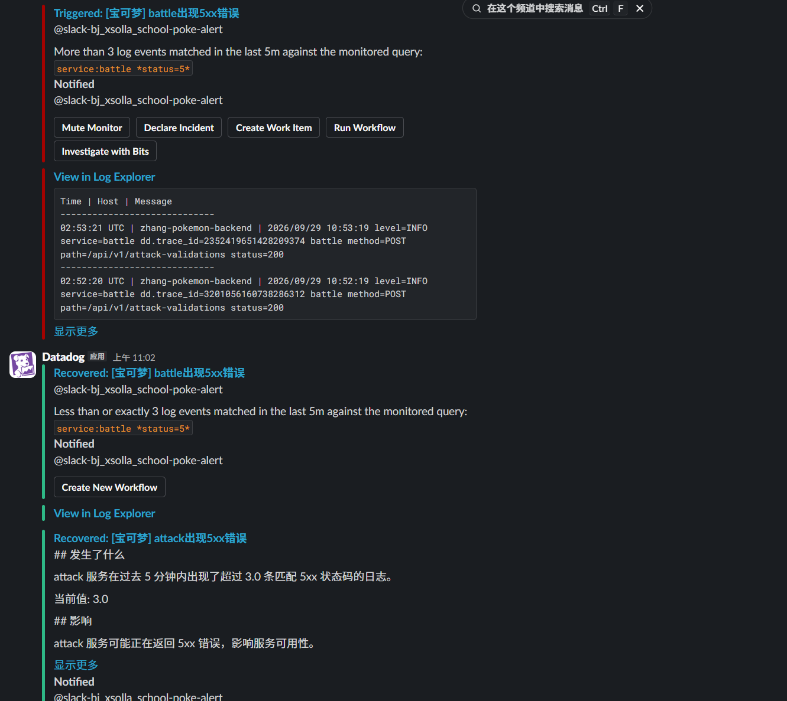

# 可观测性文档（OBSERVABILITY）

## 架构

```
浏览器（前端）
    │  POST /api/v1/attack-validations
    ▼
battle（:8080）───HTTP───▶ attack（:8081）
    │                        │
    └── dd-trace-go ─────────┘
         （分布式 trace：battle→attack 一条链路）
```

- **前端**：浏览器里的宝可梦对战游戏，玩家点击投掷球触发攻击。
- **battle**：对外网关，接收前端请求，转发给 attack，原样返回状态码。
- **attack**：校验攻击类型与固定伤害是否匹配，返回 200/400/422。

## 四大支柱埋点位置

| 支柱 | 在哪里埋的 |
|------|-----------|
| **Trace（APM）** | `attack/main.go`、`battle/main.go`：`ddhttp.WrapHandler` 包裹入口，`ddhttp.WrapClient` 包裹转发客户端，battle→attack 上下文自动透传。attack 校验时打自定义 span tag `attack.type`。 |
| **日志（Log）** | `logWithTrace()` 函数输出 `level= service= dd.trace_id=` 结构化日志，实现 log↔trace 互跳。失败路径（422/500/转发失败）打 ERROR，参数错误打 WARN。 |
| **指标（Metric）** | attack 每次校验后通过 DogStatsD 发 `pokemon.attack.validation.count{result:success\|failure, env, version, service, team}` 业务指标。系统资源（CPU/内存/磁盘）由 Datadog Agent 自动采集。 |
| **RUM** | 前端接入（孟令奇负责），上报页面加载、JS 错误、用户操作。 |

统一标签：`env:school`、`service:pokemoncard`、`version:1.0.0`、`team:bj-xsolla-school-group-2`，所有信号（trace/log/metric）均带以上标签。

## 监控表

> 全部 7 个已在线上 Datadog 网页中运行（UI 创建、实战验证过告警闭环）；
> monitors/ 目录下的 JSON 与之一一对应，队友可通过下方命令从 git 复现。

| 监控器 | 类别 | 阈值 | 理由 | 通知 |
|--------|------|------|------|------|
| battle 服务健康检查 | 可用性/心跳 | can_connect 5分钟均值 < 0.9（Agent 每 60 秒探测真实业务请求） | 探测贯穿 battle→attack 全链路，任一服务挂掉 1~2 分钟内发现，无需真实流量 | Slack |
| battle 出现 5xx 错误 | 错误（总闸） | 5 分钟内 5xx 日志 > 3 条 | 容忍零星波动，错误扎堆才是故障信号；所有请求都路过 battle，任何环节 5xx 都能抓到 | Slack |
| attack 出现 5xx 错误 | 错误（专报） | 5 分钟内 5xx 日志 > 3 条 | attack 独立监控：与 battle 5xx 联合定位——同红=attack 内部错；仅 battle 红=attack 挂掉/超时或 battle 自身问题 | Slack |
| 程序内部异常 | 错误（严重） | 5 分钟内"内部异常"日志 > 0 条 | panic 是崩溃路径，比 5xx 更严重，出现即报 | Slack |
| CPU 持续过高 | 资源饱和 | > 95% 持续 15 分钟 | 防误报设计：个人电脑有游戏/编译等短时飙高，持续超标才算异常 | Slack |
| 内存可用不足 | 资源饱和 | 可用率 < 10% 持续 15 分钟 | Windows 上用 system.mem.pct_usable（无 system.mem.pct） | Slack |
| P95 延迟过高 | 延迟 SLO | p95 > 500ms | battle 调 attack 的客户端超时即 500ms，P95 破线说明大量请求在等超时（典型：attack 变慢） | Slack |
| attack 校验失败率过高 | 业务结果 | 5 分钟内 `pokemon.attack.validation.count` 失败率 > 20% | 服务存活但业务逻辑失败（attack 返回 422），健康检查测不到，需独立监控 | Slack |

## 文件结构

```
backend/
  attack/main.go          # APM + 日志 + 业务指标
  battle/main.go          # APM + 日志
  datadog/
    http_check.d/conf.yaml    # battle/attack 健康检查
    pokemon.d/conf.yaml       # 日志采集
monitors/                   # 监控器定义（as-code，与线上监控器一一对应）
  battle-health-monitor.json          # ↔ 线上：battle服务健康检查
  battle-5xx-monitor.json             # ↔ 线上：battle出现5xx错误
  attack-5xx-monitor.json             # ↔ 线上：attack出现5xx错误
  cpu-monitor.json                    # ↔ 线上：CPU持续过高
  memory-monitor.json                 # ↔ 线上：内存可用不足
  battle-latency-p95-monitor.json     # ↔ 线上：P95延迟过高
  attack-validation-failure-rate-monitor.json  # ↔ 线上：attack校验失败率过高
  pokemoncard-supervisor-failure-level.json  # ↔ 线上：进程退出监控
```

## 应用监控器

用 `sync_datadog_monitor.py` 批量创建或更新（as-code）：

```bash
# .env 里配好 DD_API_KEY / DD_APP_KEY / DD_SITE
py sync_datadog_monitor.py --dry-run   # 先预览
py sync_datadog_monitor.py             # 实际应用
```

## 截图

### （a）RUM 会话 → 后端 trace → 关联日志 → 业务指标

待 RUM 接入后补充。

### （b）Slack 告警触发与恢复



上图展示：
- **触发**：battle 5 分钟内出现超过 3 条 5xx 日志，告警变红，通知到 Slack 频道
- **恢复**：错误数回落后，自动发送恢复通知
