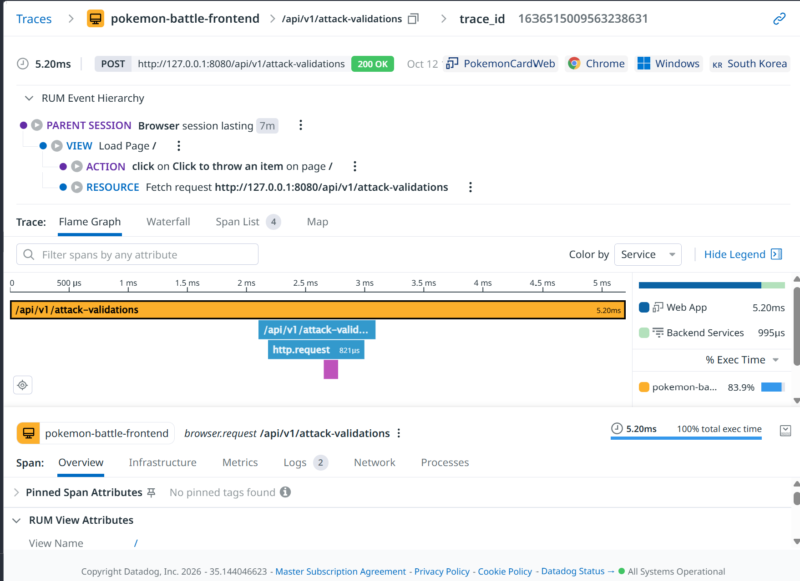
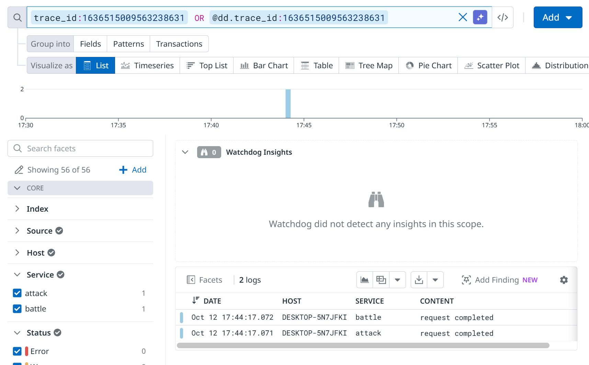
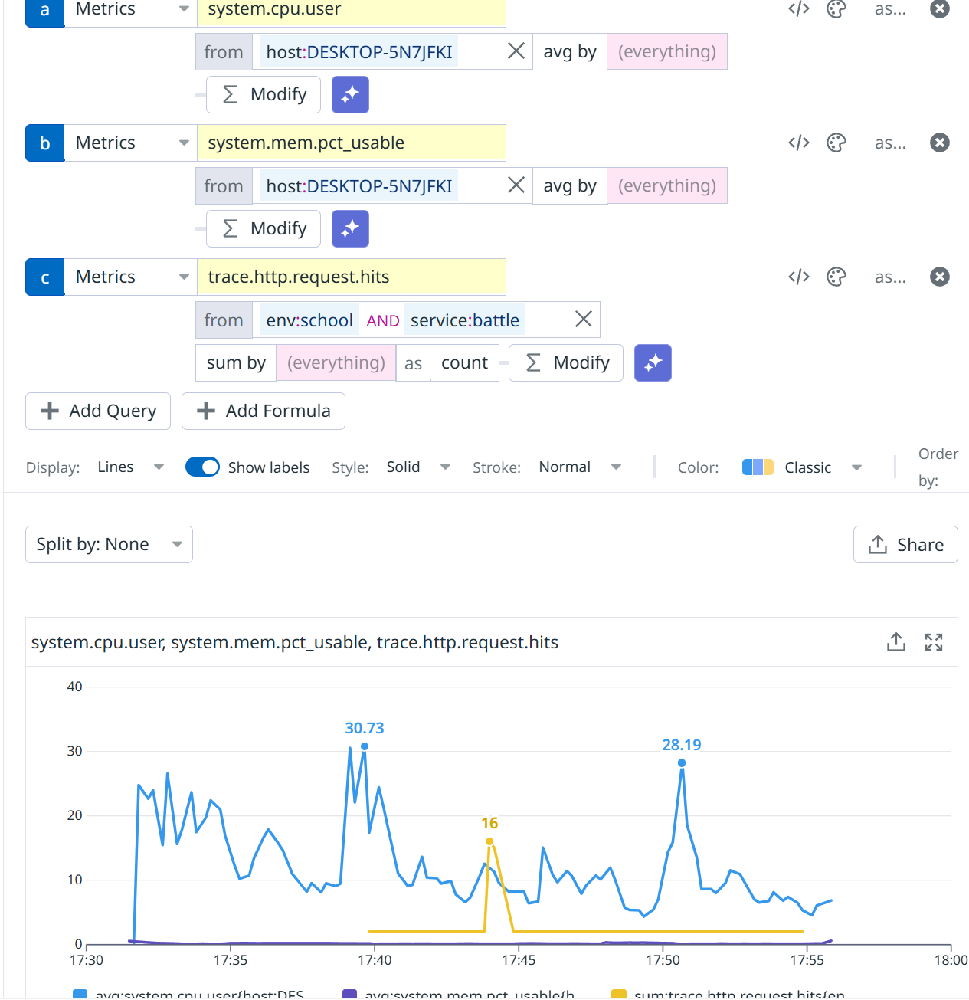

# 可观测性文档（OBSERVABILITY）

## 架构

```
浏览器（前端）
    │  POST /api/v1/attack-validations
    ▼
battle（:8080）───HTTP───▶ attack（:8081）
    │                        │
    └── dd-trace-go ─────────┘
         （分布式 trace：battle→attack 一条链路）
```

- **前端**：浏览器里的宝可梦对战游戏，玩家点击投掷球触发攻击。
- **battle**：对外网关，接收前端请求，转发给 attack，原样返回状态码， 除传数据外无其他功能。
- **attack**：校验攻击类型与固定伤害是否匹配，返回 200/400/422。

## 四大支柱埋点位置


| 支柱             | 在哪里埋的                                                                                                                                                                                                                                                                                                                                                                                                                                                 |
| -------------- | ----------------------------------------------------------------------------------------------------------------------------------------------------------------------------------------------------------------------------------------------------------------------------------------------------------------------------------------------------------------------------------------------------------------------------------------------------- |
| **Trace（APM）** | `attack/main.go`、`battle/main.go`：`ddhttp.WrapHandler` 包裹入口，`ddhttp.WrapClient` 包裹转发客户端，battle→attack 上下文自动透传。attack 校验时打自定义 span tag `attack.type`。                                                                                                                                                                                                                                                                                                  |
| **日志（Log）**    | `logWithTrace()` 函数输出 `level= service= dd.trace_id=` 结构化日志，实现 log↔trace 互跳。失败路径（422/500/转发失败）打 ERROR，参数错误打 WARN。                                                                                                                                                                                                                                                                                                                                      |
| **指标（Metric）** | attack 每次校验后通过 DogStatsD 发 pokemon.attack.validation.count{result:success\|failure, env, version, service, team} 业务指标。系统资源（CPU/内存/磁盘）由 Datadog Agent 自动采集。|
| **RUM**        | `src/monitoring/rum.js` 初始化 Datadog RUM（`PokemonCardWeb`），从 `.env` 读取应用 ID 和客户端 Token，数据上报至 us5.datadoghq.com。采集页面浏览、用户操作、网络请求和 Long Task；会话采样率为 100%，回放采样率为 20%。统一标签为 `service:pokemon-battle-frontend`、`env:school`、`version:1.0.0` 及 `team`。 |

### RUM 业务动作与看板

前端 `src/monitoring/rum.js` 提供统一业务事件封装，`BattleScene` 在实际开局、抽样攻击校验返回、对局结束和重开时记录动作。所有维度均为低基数枚举；不发送用户 ID、对局 ID 等唯一值。

| RUM action | 属性 | 口径 |
| --- | --- | --- |
| `battle_start` | `pokemon`, `enemy` | 首次点击继续进入战斗时记一次开局。 |
| `attack_submit` | `attack_type`, `result:success\|fail`, `status_code`, `latency_ms`, `attack_latency_ms` | 每次攻击实际造成伤害时记玩法成功；抽样校验返回时再记一条校验结果（200 成功，其他状态或网络失败为失败，网络失败的 `status_code` 为 0）。对局结束前仍未收到校验结果的最后一次攻击会补记失败。每种攻击每 3 次才抽样校验，因此该动作总量不等于攻击次数；用它看攻击结果或抽样校验趋势时需按 `attack_type` 区分。`latency_ms` 是服务校验耗时，`attack_latency_ms` 是攻击结算耗时。 |
| `battle_end` | `result:win\|lose\|abandon`, `rounds`, `duration_ms` | 对局终止时只记一次；篡改判定记为 abandon。这里 `rounds` 表示玩家发起的投掷次数。 |
| `battle_replay` | `prev_result:win\|lose\|abandon` | 点击再来一局时记录。 |

#### 在 Datadog 创建长期指标

在 [RUM Generate Metrics](https://us5.datadoghq.com/rum/generate-metrics) 分别按 action 名过滤，并创建 count 指标。建议仅把枚举属性加入分组维度；`latency_ms`、`duration_ms`、`rounds` 不作为 group by（可在 RUM Explorer 查看分布）。指标名称可按以下命名：

| 指标 | 过滤条件 | 分组维度 |
| --- | --- | --- |
| `rum.pokemon.battle_start.count` | `@type:action @action.name:battle_start` | `@context.pokemon`, `@context.enemy`, `version`, `device.type` |
| `rum.pokemon.attack_submit.count` | `@type:action @action.name:attack_submit` | `@context.result`, `@context.attack_type`, `@context.status_code`, `version`, `device.type` |
| `rum.pokemon.battle_end.count` | `@type:action @action.name:battle_end` | `@context.result`, `version`, `device.type` |
| `rum.pokemon.battle_replay.count` | `@type:action @action.name:battle_replay` | `@context.prev_result`, `version`, `device.type` |

创建前在 RUM Explorer 用相同过滤条件确认 action 属性路径；如租户 UI 将 action 名显示在 `@action.name` 以外的字段，使用 Explorer 展示的字段路径。指标创建后等待数据进入，再在 Metrics Explorer 确认指标可查询。

#### 建议的 Dashboard 制表

建一个 **Pokemon Battle · Business Health** Dashboard，所有图表统一使用 `service:pokemon-battle-frontend`，并添加 `env`、`version`、`device.type` 模板变量：

| Widget | 查询/计算 | 展示 |
| --- | --- | --- |
| 开局量 | `rum.pokemon.battle_start.count` | timeseries，按时间查看开局趋势。 |
| 攻击结算与抽样校验 | `rum.pokemon.attack_submit.count` 按 `result`、`attack_type` 拆分 | timeseries；该动作混合记录实际攻击结算和抽样校验结果，攻击结果在终局补报时会额外出现失败；结合 `status_code` 筛选（非零状态）观察校验结果。 |
| 终局结果 | `rum.pokemon.battle_end.count`，按 `@context.result` 拆分 | stacked timeseries；观察胜、负、放弃趋势。 |
| 胜率 | `battle_end{result:win} / (battle_end{result:win} + battle_end{result:lose}) * 100` | query value；排除 abandon。 |
| 对局结束率（近似） | 同一窗口 `battle_end count / battle_start count * 100` | query value；开局和结束跨窗口时会偏差，适合趋势观察，不作精确 cohort 转化。 |
| 再来一局率（近似） | `battle_replay count / battle_end count * 100` | query value；表示重开点击相对终局量，按时间窗口对比时会受跨窗口影响。 |
| 攻击校验延迟 | 在 RUM Explorer 查看 `attack_submit` 的 `latency_ms` 分布 | 分位数/分布视图；不按延迟值分组。 |

#### 建议的 RUM Monitors

- **攻击校验失败率**：只统计含 `status_code` 的 `attack_submit` 校验结果，`status_code:0` 代表网络失败；不把玩法成功事件混入分母。先观察基线再设阈值，短时间样本不足时设置最小事件数，避免低流量误报。
- **攻击校验延迟**：使用 `latency_ms`（校验请求耗时）观察分布；`attack_latency_ms` 是攻击结算耗时。Datadog RUM Generate Metrics 对数值属性生成长期分位分布的能力需在租户 UI 核实；也可在 RUM Explorer 看原始 action 延迟属性。
- 胜率和对局结束率先用于 dashboard 观察；在有稳定流量与基线后再设业务告警。

上述 Generate Metrics 和 Dashboard/Monitor 需要在 Datadog 账号 UI 中创建；此代码改动负责准确上报事件，本文给出可直接照做的筛选、维度和计算口径。


## 监控表

> monitors/ 目录下共 9 个 JSON，与线上 Datadog 监控器一一对应，队友可通过下方命令从 git 复现。
>
> 考虑到组内成员的工作时间，以及这个项目的大小。我们选择了可持续性最高的告警，仅仅通过 Slack 通知


| 监控器               | 类别      | 阈值                                                | 理由                                                           | 通知    |
| ----------------- | ------- | ------------------------------------------------- | ------------------------------------------------------------ | ----- |
| battle 服务健康检查     | 可用性/心跳  | can_connect 5分钟均值 < 0.9（Agent 每 60 秒探测真实业务请求）     | 需要及时发现服务是否坏了                                                 | Slack |
| battle 出现 5xx 错误  | 错误（总闸）  | 5 分钟内 5xx 日志 > 3 条                                | 流量过小，5分钟超过3条 5xx 日志足以说明问题                                    | Slack |
| attack 出现 5xx 错误  | 错误（专报）  | 5 分钟内 5xx 日志 > 3 条                                | 同上，流量小，3条也不少了。也可以和上面那个一起定位问题                                 | Slack |
| CPU 持续过高          | 资源饱和    | > 95% 持续 15 分钟                                    | 防误报设计：个人电脑有游戏/编译等短时飙高，持续超标才算异常                               | Slack |
| 内存可用不足            | 资源饱和    | 可用率 < 10% 持续 15 分钟                                | Windows 上用 system.mem.pct_usable（无 system.mem.pct）           | Slack |
| P95 延迟过高          | 延迟 SLO  | p95 > 500ms                                       | battle 调 attack 的客户端超时即 500ms，P95 破线说明大量请求在等超时（典型：attack 变慢） | Slack |
| attack 校验失败率过高    | 业务结果    | 5 分钟内 `pokemon.attack.validation.count` 失败率 > 20% | 服务存活但业务逻辑失败（attack 返回 422），健康检查测不到，需独立监控                     | Slack |
| 前端 RUM 错误         | 前端（RUM） | 5 分钟内 RUM error 事件 > 4 条                          | 前端 JS 报错用户直接感知，扎堆出现说明版本有问题                                   | Slack |
| supervisor 进程故障级别 | 进程/心跳   | `pokemoncard.supervisor.failure_level` > 0        | 进程挂掉或反复重启时 supervisor 上报，覆盖进程退出和反复崩溃                         | Slack |


## 文件结构

```
backend/
  attack/main.go          # APM + 日志 + 业务指标
  battle/main.go          # APM + 日志
  datadog/
    http_check.d/conf.yaml    # battle/attack 健康检查
    pokemon.d/conf.yaml       # 日志采集
monitors/                   # 监控器定义（as-code，与线上监控器一一对应）
  battle-health-monitor.json          # ↔ 线上：battle服务健康检查
  battle-5xx-monitor.json             # ↔ 线上：battle出现5xx错误
  attack-5xx-monitor.json             # ↔ 线上：attack出现5xx错误
  cpu-monitor.json                    # ↔ 线上：CPU持续过高
  memory-monitor.json                 # ↔ 线上：内存可用不足
  battle-latency-p95-monitor.json     # ↔ 线上：P95延迟过高
  attack-validation-failure-rate-monitor.json  # ↔ 线上：attack校验失败率过高
  pokemoncard-supervisor-failure-level.json  # ↔ 线上：进程故障级别监控
  rum-frontend-error-monitor.json     # ↔ 线上：前端JS异常
```

> 注：其余 team:bj-xsolla-school-group-2 的监控与本项目无关


## 应用监控器

用 `sync_datadog_monitor.py` 批量创建或更新（as-code）：

```bash
# .env 里配好 DD_API_KEY / DD_APP_KEY / DD_SITE
py sync_datadog_monitor.py --dry-run   # 先预览
py sync_datadog_monitor.py             # 实际应用
```


## 截图


### （a）RUM → trace → log → metric





### （b）Slack 告警触发与恢复

Slack 告警触发与恢复

上图展示：

- **触发**：battle 5 分钟内出现超过 3 条 5xx 日志，告警变红，通知到 Slack 频道
- **恢复**：错误数回落后，自动发送恢复通知

