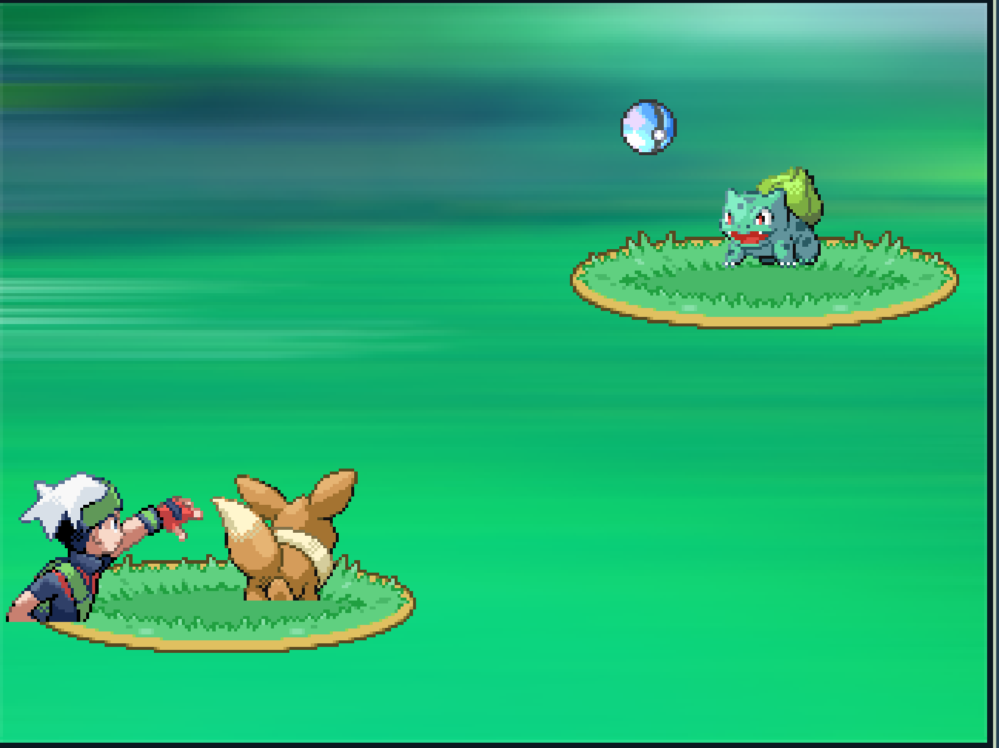

# Pokémon Battle Demo

```bash
npm install
npm run dev
```


准备做一个类似 宝可梦对战的 游戏，玩家仅仅需要通过鼠标点击来玩这个游戏。



# 基础玩法

每次玩家点击，角色会扔出去一个球，来砸对方的宝可梦造成伤害

对方的宝可梦和我方的宝可梦会不断的进行撞击。

我方收到的伤害主要来源于对方宝可梦的攻击

对方受到的伤害主要来源于角色投掷球砸出来的伤害

我方宝可梦伤害很低，主要用来当肉盾

可以有血条，经验值。

升级后，提升玩家的力量和攻击速度，提升我方宝可梦的生命值和一点点攻击力


# 其他想法

想做成挂机刷怪类的游戏。

设置 5 个左右的道馆 或者 地区，玩家想玩就猛猛点然后打高级的怪，不想点就去慢慢刷低级的怪。

如果我方宝可梦等级很高的话可以挂机打低等级的宝可梦。

通关之后变成岩石系伊布。


